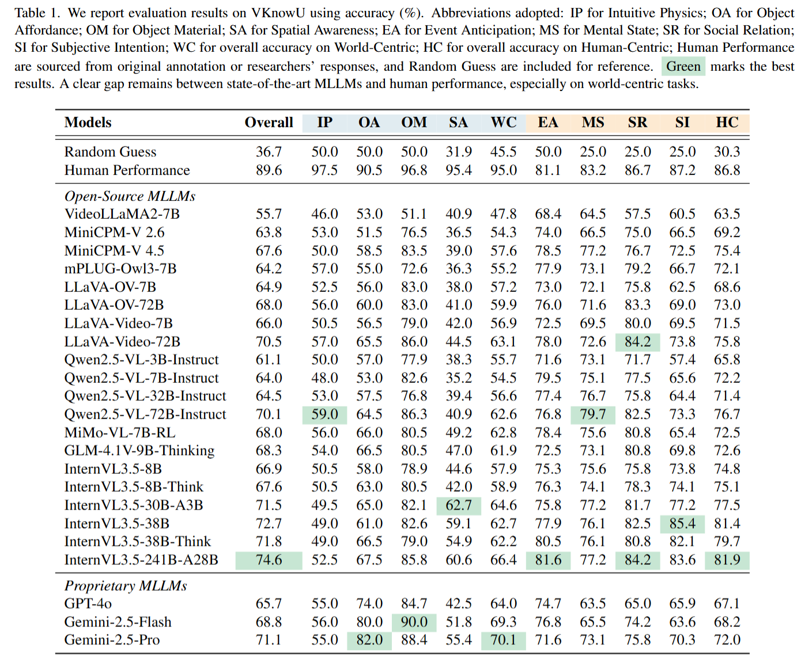

# 📊 VKnowU: Evaluating Visual Knowledge Understanding in Multimodal LLMs

<p align="center">
    📖 <a href="https://arxiv.org/abs/2511.20272">ArXiv</a>
    &nbsp;&nbsp;│&nbsp;&nbsp;
    📊 <a href="https://huggingface.co/datasets/Eurayka/VKnowU">VKnowU</a>
    &nbsp;&nbsp;│&nbsp;&nbsp;
    📀 <a href="https://huggingface.co/datasets/Eurayka/VKnowQA">VKnowQA</a>
    &nbsp;&nbsp;│&nbsp;&nbsp;
    🤗 <a href="https://huggingface.co/Eurayka/VideoKnow">Video-Know+</a>
    &nbsp;&nbsp;│&nbsp;&nbsp;
    <a href="https://hub.opencompass.org.cn/dataset-detail/VKnowU"></a>
</p>

<!-- [](https://arxiv.org/abs/2511.20272)
[](https://huggingface.co/datasets/Eurayka/VKnowU) -->


<!-- 🚀✨🔧✅📝💡🔍📊📀 -->


<div align="center">

</div>

## <a id="Overview"> 🔎 Overview</a>

While Multimodal Large Language Models (MLLMs) have become adept at recognizing objects, they often lack the intuitive, human-like understanding of the world's underlying physical and social principles. This high-level vision-grounded semantics, which we term $\textbf{\textit{visual knowledge}}$, forms a bridge between perception and reasoning, yet remains an underexplored area in current MLLMs.
To systematically evaluate this capability, we present [📊VKnowU](https://huggingface.co/datasets/Eurayka/VKnowU), a comprehensive benchmark featuring 1,680 questions in 1,249 videos, covering 8 core types of visual knowledge spanning both $\textit{world-centric}$ (e.g., intuitive physics) and $\textit{human-centric}$ (e.g., subjective intentions). Evaluation of 23 SOTA MLLMs reveals that leading models still fall short of human performance, with particularly notable gaps in the world-centric.
To bridge this gap, we introduce a new dataset, [📀VKnowQA](https://huggingface.co/datasets/Eurayka/VKnowQA), and [🤗VideoKnow+](https://huggingface.co/Eurayka/VideoKnow), a baseline model that explicitly incorporates visual knowledge into MLLMs. VideoKnow+ follows a structured $\textit{See–Think–Answer}$ paradigm and adopts reinforcement learning with visual knowledge reward, achieving a +3.7\% improvement on VKnowU and consistent gains on MVBench, Video-MME, and MMVU.
Our work highlights visual knowledge as a missing cornerstone for developing more generalizable MLLMs that can not only see but also truly understand our physical and social worlds.


<div align="center">

</div>


## <a id="ToDo"> 🔧 ToDo</a>

<!-- **状态**: ✅ 已完成 | 🚧 开发中 | ⏳ 计划中 -->

✅ Release the training and evaluation codes of VideoKnow+

✅ Release the benchmark：[VKnowU](https://huggingface.co/datasets/Eurayka/VKnowU) 

✅  Release the model weights of [🤗VideoKnow+](https://huggingface.co/Eurayka/VideoKnow)

✅ Release the 30K training datasets：[📀VKnowQA-CS-12K](https://huggingface.co/datasets/Eurayka/VKnowQA) and [📀VKnowQA-30K](https://huggingface.co/datasets/Eurayka/VKnowQA)


## <a id="Setup"> 🛠️ Set up</a>

### Requirements
* `Python >= 3.11`
* `Pytorch >= 2.5.1`
* `transformers == 4.51.3`
* `vLLM == 0.7.3`
* `trl == 0.16.0`

### Installation
```bash
git clone https://github.com/OpenGVLab/VKnowU
cd VKnowU

# Create and activate environment
conda create -n VKnowU python=3.11 
conda activate VKnowU
bash setup.sh
```

## 🚀 Training

### Supervised Fine-Tuning (SFT)
We begin with supervised fine-tuning on the [📀VKnowQA-CS-12K](https://huggingface.co/datasets/Eurayka/VKnowQA) dataset for one epoch:

```bash
bash ./src/scripts/run_sft_video.sh
```
<!-- 
This step can be skipped by directly using our pretrained SFT models, available at [🤗VideoRFT-SFT-7B](https://huggingface.co/QiWang98/VideoRFT-SFT) or [🤗VideoRFT-SFT-3B](https://huggingface.co/QiWang98/VideoRFT-SFT-3B). -->

### Reinforcement Learning (RL)

Next, perform reinforcement learning using the [📀VKnowQA-30K](https://huggingface.co/datasets/Eurayka/VKnowQA) dataset (using vLLM acceleration to enable faster training):

1. Employ an external verifier MLLM for calculate visual knowledge reward and modify the corresponding api in [here](https://github.com/OpenGVLab/VKnowU/tree/main/src/r1-v/src/open_r1/grpo_caption.py).

2. Run the RL scripts:
```bash
bash ./src/scripts/run_grpo_vllm_qwen25vl.sh
```

> **Note:** During training, we adopt the following settings for efficiency:

* **VIDEO PIXELS**: 128 × 28 × 28
* **FPS FRAMES**: 16

All frame-related configurations can be adjusted in `src/qwen-vl-utils`.

## 📈 Evaluation

> During inference, we increase the maximum frame resolution and length to boost performance:

* **VIDEO PIXELS**: 256 × 28 × 28
* **FPS FRAMES**: 32

You can configure these parameters in `src/qwen-vl-utils`.


### Evaluation Procedure

#### 📊 VKnowU
1. Download the video and json data from [VKnowU](https://huggingface.co/datasets/Eurayka/VKnowU) and organize them.

2. Run the evaluation on VKnowU:

```bash
bash ./src/eval_vknowu.sh
```

3. Caculate overall accuracy:
```
python ./src/eval/calculate_vknowu.py
```

#### 📊 Other Video Benchmarks
1. Download the video data from the official sites of each benchmark and organize them as specified in the JSON files in the [eval_data](https://github.com/OpenGVLab/VKnowU/tree/main/eval_data).

2. Run the evaluation across other video benchmarks:

```bash
bash ./src/eval_bench.sh
```
3. Caculate overall accuracy:
```
python ./src/eval/calculate_bench.py
```

<!-- <div align="center">

</div> -->

## 🙏 Acknowledgements

We gratefully acknowledge the contributions of the open-source community, particularly [R1-V](https://github.com/Deep-Agent/R1-V) and [VideoRFT](https://github.com/QiWang98/VideoRFT).


## 📚 Citations

If you find this work helpful, please consider citing:

```
@article{jiang2025vknowu,
  title={VKnowU: Evaluating Visual Knowledge Understanding in Multimodal LLMs},
  author={Jiang, Tianxiang and Xia, Sheng and Xu, Yicheng and Wu, Linquan and Zeng, Xiangyu and Wang, Limin and Qiao, Yu and Wang, Yi},
  journal={arXiv preprint arXiv:2511.20272},
  year={2025}
}
```